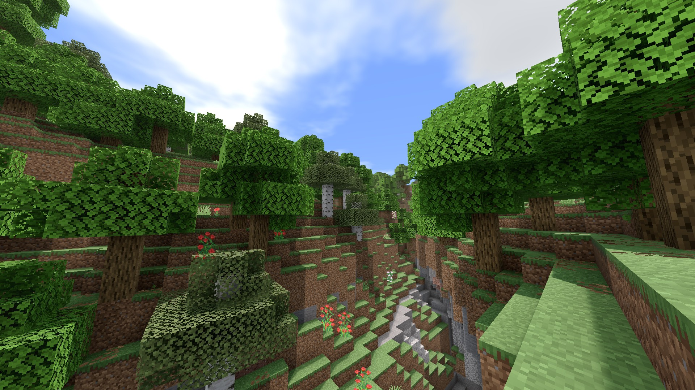
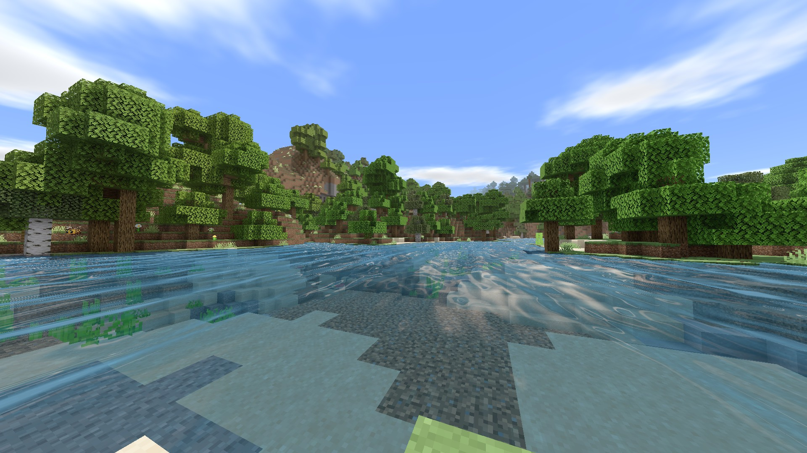
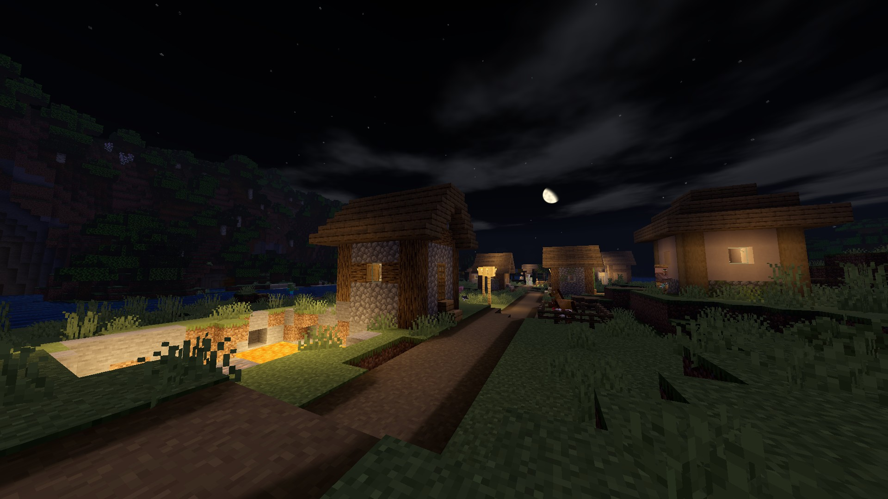

# Natural Mystic PLUS

**Natural Mystic Plus** is an updated version of [PHO](https://github.com/depressed-pho)’s [Natural Mystic Shaders](https://github.com/depressed-pho/natural-mystic-shaders) for Minecraft bedrock edition.

## Changes from the original project:

* Updated for the latest version (1.26.50+)
* Added cloud reflection for water
* Better detection hacks

## Supported platforms
* Windows (Direct3D Shader Model 4.0+)
* Android (OpenGL ES 3.1+)
* iOS (Untested & Unrecommended)

## Screenshots

## Installations
Install these tools depending on your device:

* Windows: [BetterRenderDragon](https://github.com/QYCottage/BetterRenderDragon) or [Wyvern Loader](https://github.com/mcbegamerxx954/wyvern_releases)
* Android: [MB Loader](https://play.google.com/store/apps/details?id=io.github.bambosan.mbloader)

And now, your game is able to load shaders from resource packs.
See [releases](https://github.com/Rinloid/natural-mystic-plus/releases) to download the .mcpack and apply it!

If your are on iOS, unfortunately you have to relpace the material.bin files inside your application file manually.

## Building
Install [Lazurite](https://github.com/veka0/lazurite) and follow its documentation to build.

## License
[CC0](https://creativecommons.org/share-your-work/public-domain/cc0/)
“No Rights Reserved”